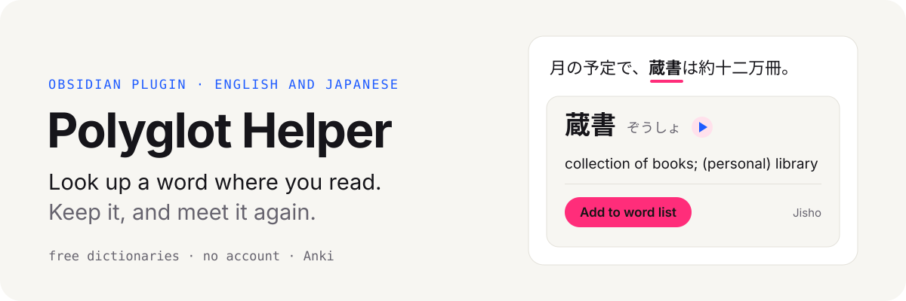
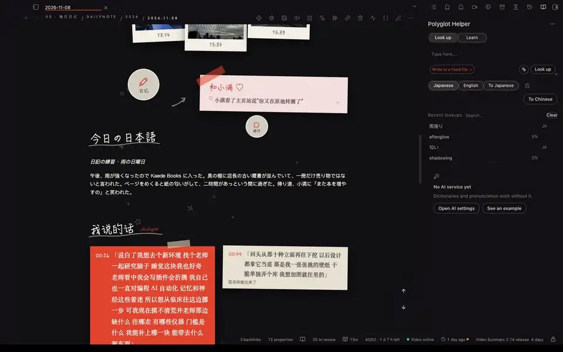
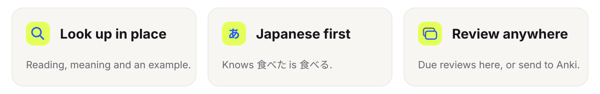
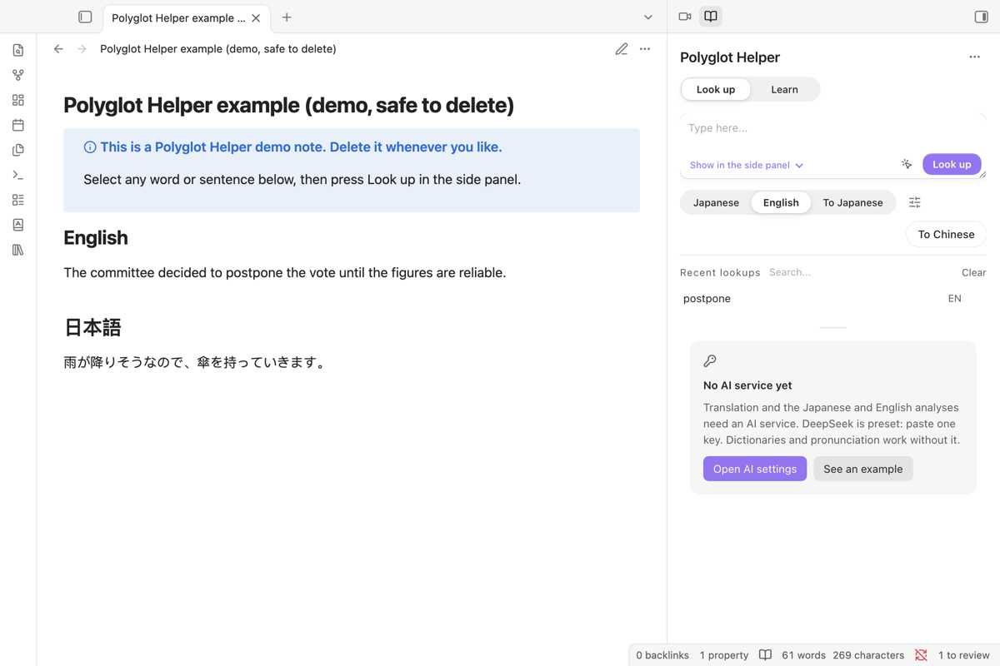
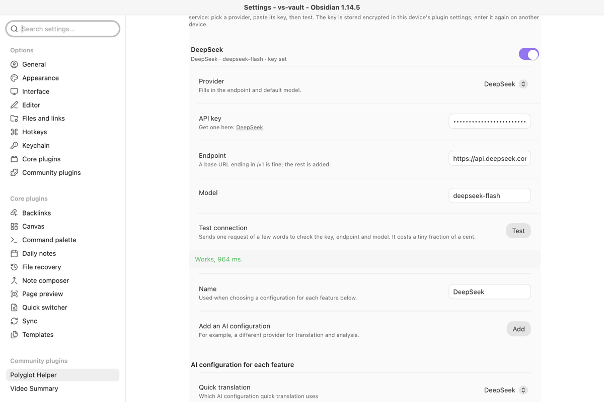
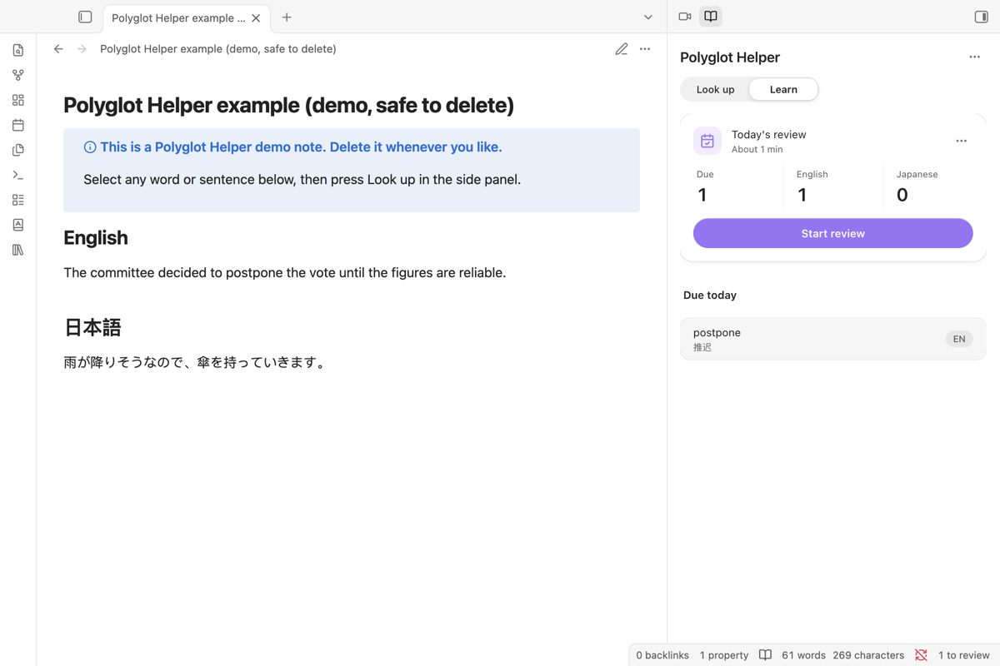
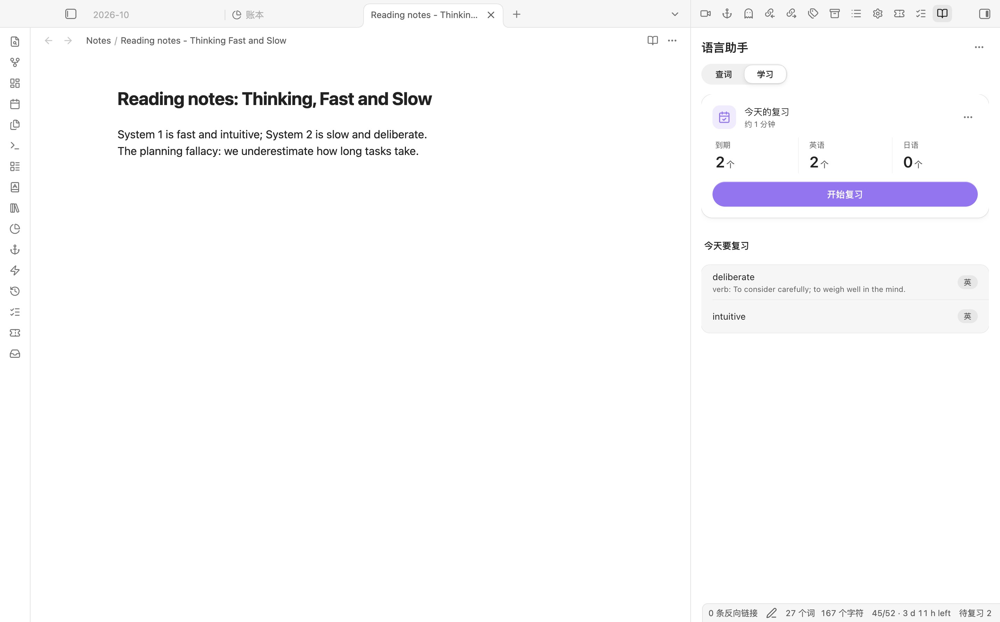

<a href="README.zh-CN.md">中文</a> · <a href="README.ja.md">日本語</a>

<picture><source media="(prefers-color-scheme: dark)" srcset="assets/readme/icon-dark.svg"></picture>

<picture>
  <source media="(prefers-color-scheme: dark)" srcset="assets/readme/hero-dark.svg">
  
</picture>

<a href="https://community.obsidian.md/plugins/polyglot-helper"><b>Obsidian からインストール</b></a> · <a href="https://rexxall.github.io/polyglot-helper/">使い方を見る</a>

<picture>
  <source media="(prefers-color-scheme: dark)" srcset="assets/readme/cards-dark.svg">
  
</picture>

## 3 ステップで始める

1. 「Settings → Community plugins → Browse」から **Polyglot Helper** をインストールし、有効にします。
2. ノート内の単語を選び、右クリックして **「Quick word card」** を選びます。
3. **「Add to word list」** を押します。保存した単語は復習の対象になり、読むときにも下線で表示されます。

**動作環境** Obsidian <!-- DOCS-SYNC:START min -->1.11.4<!-- DOCS-SYNC:END --> 以降。<!-- DOCS-SYNC:START platform -->デスクトップとモバイルに対応<!-- DOCS-SYNC:END -->しています。**費用** プラグインと辞書は無料で、アカウントは不要です。詳しい単語情報と文中での意味を調べるには、自分の OpenAI 互換 API キーが一つ必要です。初期設定は DeepSeek です。利用料金は選んだサービスから請求されます。単語の検索 1 回につき、短いリクエストを送ります。

うまく動かないときは、[AI アシスタントに貼る確認用プロンプト](docs/troubleshooting.ja.md)をどうぞ。

## その他

<b>初回の使い方</b>

1. Polyglot Helper をインストールして有効にします。左のリボンにある本のアイコンを押すと、サイドパネルが開きます。
2. **「Load example」** を押します。デモと明記した短いノートが作られ、検索欄に「postpone」が入ります。このノートはいつでも削除できます。
3. **「Settings → Polyglot Helper → Translation and models」** で AI のキーを一つ選ぶか、新しく作ります。初期設定は DeepSeek です。**「Test」** を押して接続を確認します。
4. **「Look up」** を押します。次からはノート内の単語を選び、同じように調べられます。**「Add to word list」** で保存すると、後で復習できます。

<b>機能一覧</b>

- **単語カード：** 単語を選び、「Quick word card (selected word)」を実行します。右クリックメニューからも開けます。単語のそばにカードが開き、読み、短い意味、文中での意味、例文を一つ表示します。
- **英語：** 意味、発音記号、例文、コロケーション、語源、イディオム、スラングを調べられます。設定で有効にすると、医学用語の用法も表示します。Free Dictionary、Cambridge、Merriam-Webster、Urban Dictionary、Etymonline、TheFreeDictionary のイディオム辞典、Tatoeba を並行して検索します。モデルが辞書の記述に沿って、一つの項目にまとめます。
- **日本語：** かなの読み、意味、Jisho と Tatoeba の例文、関連語を表示します。OpenAI、Gemini、Youdao の音声読み上げにも対応しています。
- **クイック翻訳：** 選択した文章を中国語または日本語に翻訳します。
- **出力先：** サイドパネル、選択範囲、ノートの末尾、新規ノート、指定ファイルから選べます。保存先のパスは言語ごとに設定できます。
- **単語帳：** クリック一つで、単語と出典のノート・文を保存します。同じ単語を再度追加すると、既存の項目に統合します。復習間隔は変更できます。初期設定は 1、3、7、14、30、90、180 日です。ステータスバーに復習が必要な単語数を表示します。
- **複数の意味：** 保存済みの単語を追加するときは、その文を既存の意味に追加するか、新しい意味として保存するかを選べます。新しい意味は個別に復習できます。
- **読んでいるときの表示：** リーディングビューでは、単語帳にある語に下線が付きます。日本語の動詞や形容詞は活用形にも対応しています。たとえば「食べる」を保存すると「食べた」にも下線が付きます。ポインターを合わせると、読みと意味が表示されます。
- **Anki への送信：** AnkiConnect アドオンを通じて、コマンド一つで送れます。新しい単語はデッキにカードとして追加し、変更した単語は既存のカードを更新します。重複は作りません。
- **エクスポート：** Spaced Repetition 用のフラッシュカードノート、または Anki のインポートファイルに書き出せます。各カードには固定の ID と元のノートへのリンクが付きます。再エクスポートしても復習予定を保持し、Anki に再インポートすると同じカードを更新します。
- **キャッシュ：** 同じ検索は 2 回目から費用がかかりません。キャッシュの整理パネルは、このプラグインのキャッシュだけを対象にします。

<table>
<tr>
<td width="50%"> 設定前のパネルには、不足している設定と、AI 設定やサンプルを開く操作が表示されます。</td>
<td width="50%"> プロバイダー、キー、エンドポイント、モデルは別々の欄で設定します。<b>「Test」</b> で問題の内容を確認できます。</td>
</tr>
<tr>
<td width="50%"> 保存した単語は、復習日になると「Learn」ページに表示されます。</td>
<td width="50%"> カードを 1 枚ずつ復習し、どのくらい覚えていたかを評価します。</td>
</tr>
</table>

<b>必要なものと費用</b>

| 項目 | 内容 |
| --- | --- |
| プラグイン | 無料で、アカウントは不要です。Obsidian <!-- DOCS-SYNC:START min -->1.11.4<!-- DOCS-SYNC:END --> 以降のデスクトップとモバイルで使えます。 |
| AI サービス | OpenAI 互換のキーが一つ必要です。DeepSeek（初期設定）、Qwen（通义千问）、SiliconFlow（硅基流动）、Kimi、Zhipu GLM（智谱）、OpenRouter、OpenAI のプリセットがあります。他の互換エンドポイントも使えます。料金は各サービスの従量課金です。単語の検索 1 回につき、短いリクエストを送ります。**「Test」** にも 1 セントを大きく下回る少額の費用がかかります。SiliconFlow は残高がゼロだと、無料モデルでもリクエストを受け付けません。 |
| 辞書と発音 | 無料の公開ソースはキーなしで使えます。任意で設定できるキーは、Merriam-Webster（類語辞典・医学用語）と、日本語の音声読み上げ用の OpenAI、Gemini、Youdao です。 |

<b>AI サービス</b>

**「Settings → Translation and models」** でプロバイダーを選ぶと、エンドポイントとモデルが自動で入力されます。キーは自分で選びます。ベース URL は `/v1` で終わる形式でも使えます。

| プロバイダー | 既定のモデル | キー |
| --- | --- | --- |
| DeepSeek（初期設定） | `deepseek-flash` | [platform.deepseek.com](https://platform.deepseek.com/api_keys) |
| Qwen（通义千问） | `qwen-plus` | [Bailian コンソール](https://bailian.console.aliyun.com/?apiKey=1) |
| SiliconFlow（硅基流动） | `deepseek-ai/DeepSeek-V4.1-Flash` | [cloud.siliconflow.cn](https://cloud.siliconflow.cn/account/ak) |
| Kimi | `kimi-k3` | [platform.kimi.com](https://platform.kimi.com/console/api-keys) |
| Zhipu GLM（智谱） | `glm-5.3` | [bigmodel.cn](https://bigmodel.cn/usercenter/proj-mgmt/apikeys) |
| OpenRouter | `google/gemini-2.5-flash` | [openrouter.ai](https://openrouter.ai/keys) |
| OpenAI | `gpt-4o-mini` | [platform.openai.com](https://platform.openai.com/api-keys) |
| 「Custom」 | 任意の OpenAI 互換エンドポイント | |

**「Test」** は、キーの未設定、キーの拒否（401/403）、残高や利用枠の不足、不明なモデル名、応答のタイムアウト、エンドポイントへの接続失敗を区別します。それぞれの対処方法も表示します。

<b>プライバシーとデータ</b>

| データ | 送信先 | 保存先 |
| --- | --- | --- |
| 調べる単語や文 | 有効にした辞書と AI サービス | プラグインフォルダー内の検索キャッシュです。 |
| API キー | そのキーに対応するサービスのみ | この端末の Obsidian のキーチェーン（**「Settings → Keychain」** ）に保存します。`data.json` に残るのは、`deepseek-api-key` などのキー名だけです。同じ名前を使う他のプラグインでも、そのキーを選べます。キーは保管庫と一緒には同期されません。別の端末では、もう一度選んでください。 |
| 単語帳と復習履歴 | 送信しません | プラグインフォルダー内の `data.json` です。 |
| デバッグログ | 送信しません | デバッグモードが有効なときだけ書き込みます。キーや検索した文章は含めません。 |

**ネットワーク通信：** 有効にした項目に応じて、AI サービス、dictionaryapi.dev、Cambridge Dictionary、Etymonline、Merriam-Webster（自分のキーを使用）、Jisho、Tatoeba、YourDictionary、WordHippo、The Free Dictionary のイディオム辞典、非公式の Urban Dictionary API に検索リクエストを送ります。音声読み上げには、選んだ OpenAI、Gemini、Youdao のサービスを使います。**「Send word list to Anki」** は、このコンピューターの AnkiConnect（`127.0.0.1:8765`）にだけ接続します。プラグイン独自のアカウントやサーバーはありません。

<b>手動インストール・リリースの検証・1.5 からの更新</b>

[最新リリース](https://github.com/Rexxall/obsidian-polyglot-helper/releases/latest)から `main.js`、`manifest.json`、`styles.css` をダウンロードし、`<your vault>/.obsidian/plugins/polyglot-helper/` に置きます。次に **「Settings → Community plugins」** で **Polyglot Helper** を有効にします。通常は **「Settings → Community plugins → Browse」** からインストールできます。ここは手動で入れる場合の手順です。

1.9.1 以降は、リリース用ワークフローで 3 つの配布ファイルに署名付きのビルド来歴証明を付けています。ダウンロードしたファイルは、`gh attestation verify main.js --repo Rexxall/obsidian-polyglot-helper` で検証できます。

**1.5 以前からの更新：** プラグイン ID が `obsidian-polyglot-helper` から `polyglot-helper` に変わりました。旧版を無効にしてから、新版を有効にしてください。同じペインを登録するため、両方を同時に動かさないでください。新版は初回起動時に、旧版の設定、API キー、両言語の単語帳と復習履歴をコピーします。旧版のフォルダーはそのまま残ります。検索キャッシュは引き継ぎません。ホットキーは設定し直してください。

<b>既知の制限</b>

- Cambridge、Etymonline、イディオム辞典など、一部の情報源は API ではなくウェブページです。サイトの構成が変わると、その項目は空になることがあります。
- 単語情報の品質は、選んだモデルに左右されます。珍しい単語は辞書でも確認してください。
- スマートフォンでは、音声読み上げや大きな単語帳の処理に時間がかかります。

不具合の報告は [github.com/Rexxall/obsidian-polyglot-helper/issues](https://github.com/Rexxall/obsidian-polyglot-helper/issues) へどうぞ。各バージョンの変更は [CHANGELOG.md](CHANGELOG.md)、ソースからのビルド方法は [CONTRIBUTING.md](CONTRIBUTING.md) を参照してください。ライセンスは MIT です。
