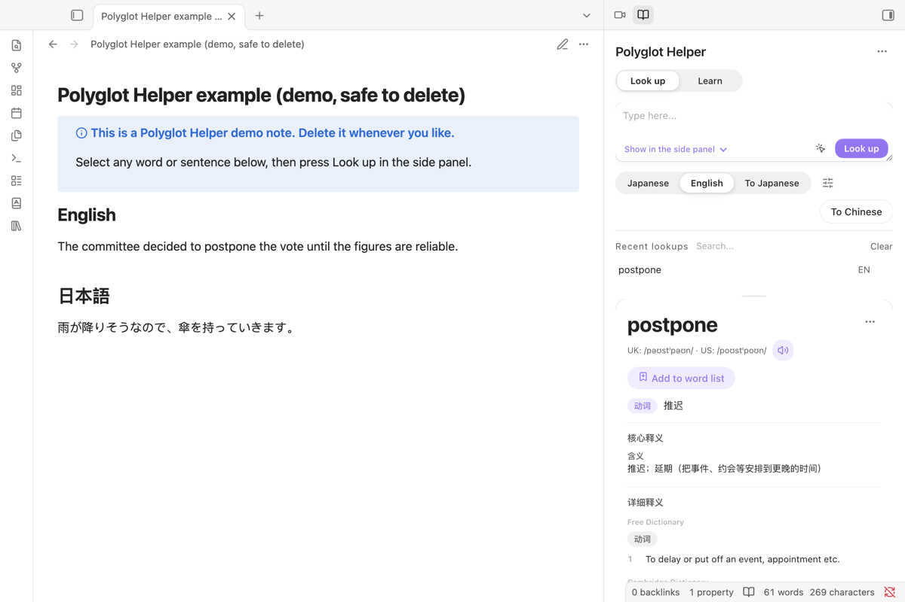
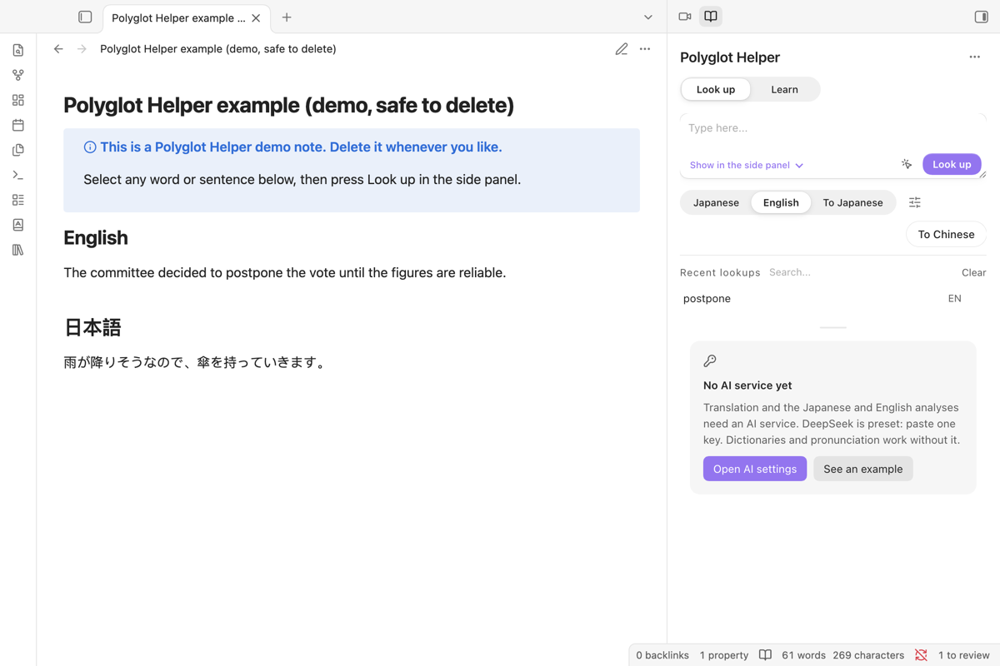
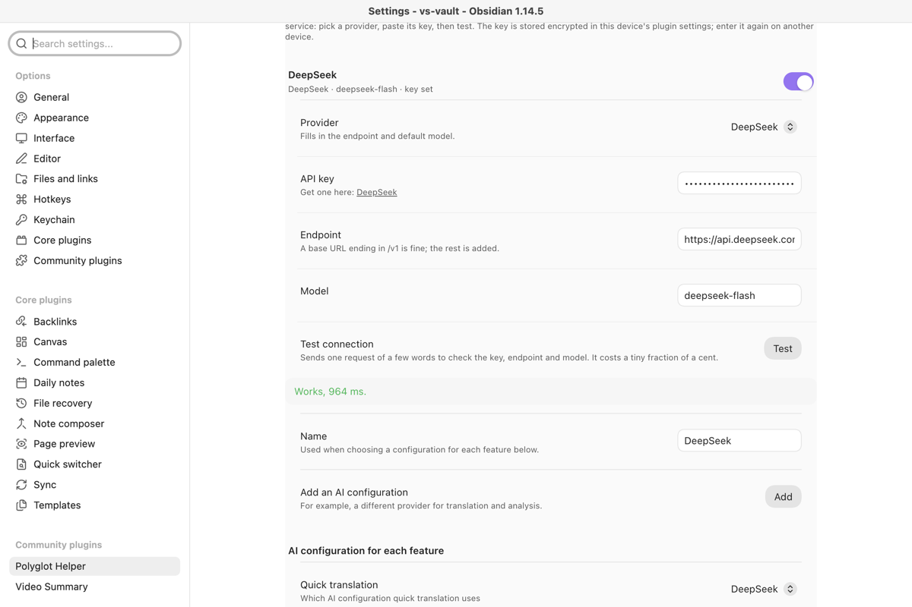
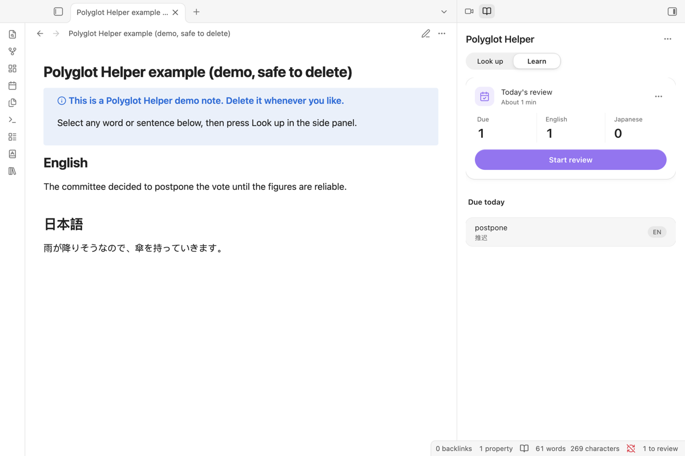

# Polyglot Helper

**Look up an English or Japanese word in your note and get back a study card — meaning, reading, examples and audio — that goes into a word list you review.**

English · [中文](README.zh-CN.md) · [日本語](README.ja.md)

## Start here

1. Install and enable Polyglot Helper, then click the book icon in the left ribbon to open the side panel.
2. Press **Load example**. It writes a short note marked as a demo (delete it whenever you like) and puts “postpone” in the lookup box.
3. Paste one AI key: **Settings → Polyglot Helper → Translation and models**. DeepSeek is preset; press **Test** to check it.
4. Press **Look up**. Next time, select any word in a note and look it up the same way; **Add to word list** keeps it for review.

## What you need and what it costs

|                                |                                                                                                                                                                                                                                                                                                       |
| ------------------------------ | ----------------------------------------------------------------------------------------------------------------------------------------------------------------------------------------------------------------------------------------------------------------------------------------------------- |
| The plugin                     | Free, no account. Works on desktop and mobile.                                                                                                                                                                                                                                                        |
| An AI service                  | One OpenAI-compatible key. Presets: DeepSeek (default), Qwen (通义千问), SiliconFlow (硅基流动), Kimi, Zhipu GLM (智谱), OpenRouter, OpenAI, or any compatible endpoint. Billed by that provider per use; one word lookup is a short request. **Test** costs a tiny fraction of a cent. SiliconFlow refuses even its free models while the account balance is zero. |
| Dictionaries and pronunciation | Free public sources, no key. Optional keys: Merriam-Webster (thesaurus and medical sections) and OpenAI, Gemini or Youdao for Japanese speech.                                                                                                                                                       |

## What it does

- **Lookup card:** select a word and run "查词小卡" (or right-click). A card opens next to the word with the reading, a short meaning, what it means in this sentence and one example.
- **English:** definitions, phonetics, examples, collocations, etymology, idioms, slang and, if you turn it on, medical usage. Free Dictionary, Cambridge, Merriam-Webster, Urban Dictionary, Etymonline, TheFreeDictionary idioms and Tatoeba are queried in parallel, and the model merges them into one entry, staying with what the dictionaries say.
- **Japanese:** kana reading, meaning, examples from Jisho and Tatoeba, related words, and speech from OpenAI, Gemini or Youdao.
- **Quick translation** of a selection into Chinese or Japanese.
- **Where results go:** the side panel, the selection, the end of the note, a new note or a fixed file, with separate paths per language.
- **Word list:** one click adds a word with the note and sentence it came from; adding it again merges. Review on a schedule you can change (default 1, 3, 7, 14, 30, 90, 180 days); the status bar shows how many are due.
- **Export** to a Spaced Repetition flashcard note (re-exporting keeps its schedule) or an Anki import file.
- **Cache:** the same lookup costs nothing the second time; the cleanup panel only touches the plugin's own cache.

## Screens

<table>
<tr>
<td width="50%"> Before setup, the panel says what is missing and offers the AI settings or an example.</td>
<td width="50%"> Provider, key, endpoint and model are separate fields; <b>Test</b> says exactly what is wrong.</td>
</tr>
<tr>
<td width="50%"> Words you add come back on the Learn page when they are due.</td>
<td width="50%"> Review one card at a time and grade how well you knew it.</td>
</tr>
</table>

## Install

Download `main.js`, `manifest.json` and `styles.css` from the [latest release](https://github.com/Rexxall/obsidian-polyglot-helper/releases/latest) into `<your vault>/.obsidian/plugins/polyglot-helper/`, then enable **Polyglot Helper** in **Settings → Community plugins**. Once the plugin is listed, install it from **Settings → Community plugins → Browse** instead.

**Upgrading from 1.5 or earlier.** The plugin ID changed from `obsidian-polyglot-helper` to `polyglot-helper`. Turn the old plugin off, then the new one on; do not run both, they register the same panes. On first start the new version copies the old settings, API keys and both word lists with their review history, and leaves the old folder untouched. The lookup cache is not carried over, and hotkeys need assigning again.

## AI services

Pick a provider in **Settings → Translation and models**; the endpoint and model are filled in and you paste the key. A base URL ending in `/v1` is fine.

| Provider               | Default model                     | Key                                                             |
| ---------------------- | --------------------------------- | --------------------------------------------------------------- |
| DeepSeek (default)     | `deepseek-flash`                  | [platform.deepseek.com](https://platform.deepseek.com/api_keys) |
| Qwen (通义千问)        | `qwen-plus`                       | [Bailian console](https://bailian.console.aliyun.com/?apiKey=1) |
| SiliconFlow (硅基流动) | `deepseek-ai/DeepSeek-V4.1-Flash` | [cloud.siliconflow.cn](https://cloud.siliconflow.cn/account/ak) |
| Kimi                   | `kimi-k3`                         | [platform.kimi.com](https://platform.kimi.com/console/api-keys) |
| Zhipu GLM (智谱)       | `glm-5.3`                         | [bigmodel.cn](https://bigmodel.cn/usercenter/proj-mgmt/apikeys) |
| OpenRouter             | `google/gemini-2.5-flash`         | [openrouter.ai](https://openrouter.ai/keys)                     |
| OpenAI                 | `gpt-4o-mini`                     | [platform.openai.com](https://platform.openai.com/api-keys)     |
| Custom                 | Any OpenAI-compatible endpoint    |                                                                 |

**Test** tells these apart, each with what to do: no key yet; key rejected (401/403); no balance or quota; unknown model name; no answer in time; endpoint unreachable.

## Privacy and data

| What                               | Goes to                                         | Stored                                                                                                                                                                             |
| ---------------------------------- | ----------------------------------------------- | ---------------------------------------------------------------------------------------------------------------------------------------------------------------------------------- |
| The word or sentence you look up   | The dictionaries you enable and your AI service | Lookup cache in the plugin folder                                                                                                                                                  |
| Your API keys                      | Only to the service they belong to              | Encrypted in the plugin's `data.json`. The decryption key stays in this device's local storage for this vault, so a synced or copied `data.json` does not expose your keys; on another device you enter them once more. |
| Word list and review history       | Nowhere                                         | `data.json` in the plugin folder                                                                                                                                                   |
| Debug log                          | Nowhere                                         | Written only when debug mode is on; keys and looked-up text are left out                                                                                                           |

**Network use.** Depending on the sections you enable, lookups go to your AI service and to dictionaryapi.dev, Cambridge Dictionary, Etymonline, Merriam-Webster (with your key), Jisho, Tatoeba, YourDictionary, WordHippo, The Free Dictionary idioms and an unofficial Urban Dictionary API. Speech uses the OpenAI, Gemini or Youdao service you pick. There is no account and no server of our own.

## Known limits

- Some sources are web pages, not APIs (Cambridge, Etymonline, idioms). If a site changes its layout, that section comes back empty.
- An entry is only as good as the model you pick; check unusual words against a dictionary.
- Speech and large word lists are slower on phones.

## Support and license

Issues: [github.com/Rexxall/obsidian-polyglot-helper/issues](https://github.com/Rexxall/obsidian-polyglot-helper/issues). Changes in each version: [CHANGELOG.md](CHANGELOG.md). Building from source: [CONTRIBUTING.md](CONTRIBUTING.md). MIT licence.
