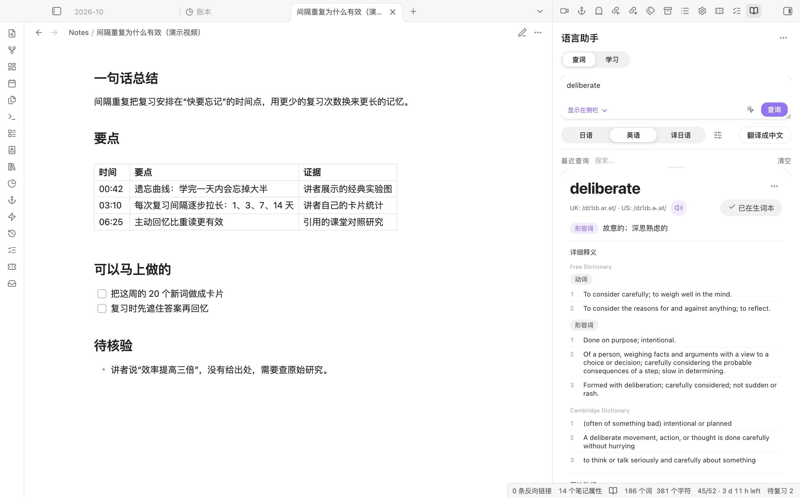
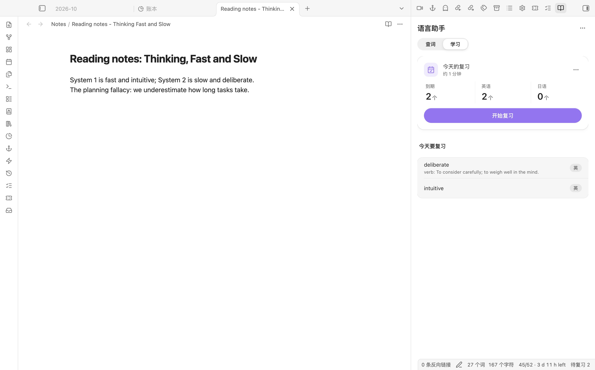
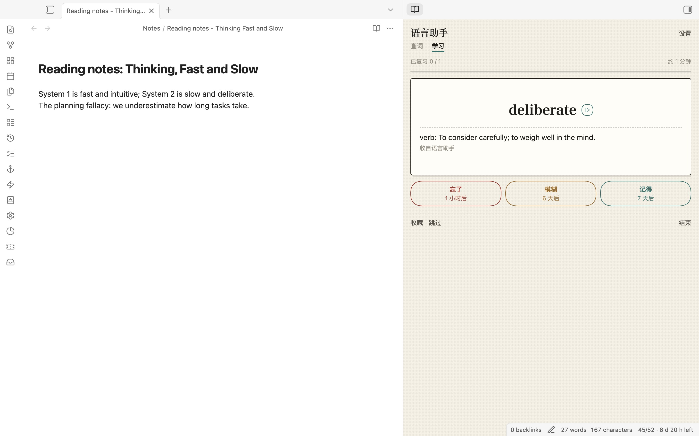

<div align="center">

# Polyglot Helper

**Select a word in your note, get a full study entry back — meaning, reading, examples, etymology and audio — and keep it for review.**

在笔记里选中一个英文或日文词，一个命令拿回释义、读音、例句、词源和语音，写进笔记并收进复习词库。

[Features](#features) · [Quick start](#quick-start) · [API setup](#api-setup) · [Privacy](#privacy) · [中文说明](#中文说明) · [日本語](#日本語)

<picture>
  <source media="(prefers-color-scheme: dark)" srcset="docs/screenshots/lookup-dark.jpg">
  
</picture>

</div>

## Why

Looking up one word while studying means five browser tabs: a dictionary for the meaning, another site for examples, a third for the reading, and then copying it all back into your notes. Polyglot Helper does the lookup and the note in one step, inside Obsidian, and keeps every word you looked up in a list you can review.

## Features



### Lookup popover

- Select a word and run "查词小卡" (or right-click → 查词小卡). A small card opens next to the word: reading, a short meaning, what it means in this sentence, one example. Save it to the vocabulary list with the sentence it came from, or open the full entry.

### English

- One command on a selected word or phrase: definitions and part of speech, phonetics, example sentences, collocations, etymology, idioms, slang, and medical usage if you turn it on.
- Sources are queried in parallel — Free Dictionary, Cambridge, Merriam-Webster (thesaurus and medical, with your own key), Urban Dictionary, Etymonline, TheFreeDictionary idioms, Tatoeba — and an LLM merges them into one entry. The prompt tells the model to stay with what the dictionaries say and only fill gaps.
- Choose which sections to include.

### Japanese

- Reading in kana, meaning, example sentences (Jisho, Tatoeba), related words.
- Text-to-speech with OpenAI, Gemini or Youdao. Audio is cached locally, so a sentence is only generated once.

### Quick translation

- Translate a selection into Chinese or Japanese with one command.

### Where the result goes

- Side panel, replace the selection, append to the current note, a new note, or a fixed file — with separate paths for English, Japanese and quick translations.

### Vocabulary and review

- Add any lookup to a vocabulary list with one click, from the side panel or the lookup popover (English and Japanese kept apart), with search, tags, import and export.
- Spaced review on a schedule you can change (default 1, 3, 7, 14, 30, 90, 180 days). The side panel's 学习 page opens on today's due count; each card has three answers, labelled with when the word comes back.

### Export and reminders

- Export the vocabulary as a Spaced Repetition flashcard note (`#flashcards/polyglot`, one `word::reading · meaning` card per line) or as an Anki import file. Re-exporting keeps Spaced Repetition's schedule comments.
- A "待复习 N" status bar item shows how many words are due; click it to review.

### Look

- Follows your Obsidian theme and light/dark mode. Optional "Paper & ink style" in settings.



### Cache

- Text and audio results are cached inside the plugin folder, so the same lookup costs nothing the second time. The cleanup panel shows sizes and removes old entries; it only touches the plugin's own cache folders.

## Quick start

1. Download `main.js`, `manifest.json` and `styles.css` from the [latest release](https://github.com/Rexxall/obsidian-polyglot-helper/releases/latest) into `<your vault>/.obsidian/plugins/polyglot-helper/`. (Once the plugin is listed, install it from **Settings → Community plugins → Browse** instead.)
2. In Obsidian, open **Settings → Community plugins** and enable **Polyglot Helper**.
3. Open the plugin settings and add one API key (see below).
4. Select a word and run **英语分析** or **日语分析** from the command palette. Assign hotkeys if you use it often.

## Upgrading from 1.5 or earlier

Earlier versions used the ID `obsidian-polyglot-helper` and lived in `.obsidian/plugins/obsidian-polyglot-helper/`. From 1.6.0 the ID is `polyglot-helper`, so Obsidian keeps it in `.obsidian/plugins/polyglot-helper/`.

1. Install 1.6.0 into the new folder (or from the community directory once listed).
2. In **Settings → Community plugins**, turn the old Polyglot Helper off, then turn the new one on. Do not run both at once; they register the same panes.
3. On first start the new version copies the old `data.json` — settings, API keys and the English and Japanese vocabulary lists with their review history — and shows a notice. The old folder is left untouched.
4. Check your words in the 学习 page, then remove the old plugin. Custom hotkeys are stored under the plugin ID, so assign them once more in **Settings → Hotkeys**.

Not carried over: the lookup cache (the first lookup of each word is fetched again). API keys move with `data.json` and still decrypt, because the device key is kept per vault, not per plugin.

## API setup

The plugin talks to any OpenAI-compatible chat API.

| Service | What to enter |
|---|---|
| OpenRouter (default) | A key from openrouter.ai. Endpoint `https://openrouter.ai/api/v1/chat/completions`, model `google/gemini-2.5-flash` |
| OpenAI | A key from platform.openai.com. Model `gpt-4o-mini` or any chat model |
| Other | Any endpoint that accepts the OpenAI chat format |

Optional: a Merriam-Webster key for the thesaurus and medical sections, and an OpenAI, Gemini or Youdao key for Japanese speech.

## Privacy

| What | Where it lives |
|---|---|
| Settings, vocabulary list, review history | `data.json` in the plugin folder |
| API keys | `data.json`, encrypted with a key kept in this device's local storage, not in `data.json` |
| Cached results and audio | `.cache/` in the plugin folder |
| The word or sentence you look up | Sent to the dictionaries and the AI service you enabled |
| Log file | Written only when **Debug mode** is on |

Network use: lookups go to the AI service you configure (OpenRouter, OpenAI or a custom OpenAI-compatible endpoint) and, depending on the sections you enable, to dictionaryapi.dev, Cambridge Dictionary, Etymonline, Merriam-Webster (with your key), Jisho, Tatoeba, YourDictionary, WordHippo, The Free Dictionary idioms and an unofficial Urban Dictionary API. Speech uses the OpenAI, Gemini or Youdao TTS service you pick. All requests use Obsidian's `requestUrl`. Some of these services need your own API key and may charge for use.

There is no account and no server of our own. Because the decryption key stays on the device, a synced or committed `data.json` does not expose your API keys; on a new device you enter them once more.

## How it works

- TypeScript, bundled with esbuild into one `main.js`.
- `english-processor.ts` and `japanese-processor.ts` run a lookup: check the cache, query the enabled sources in parallel, ask the LLM for one JSON entry, render Markdown.
- LLM requests go through Obsidian's `requestUrl` with a timeout; an error reply is shown, not swallowed.
- API keys are encrypted with AES-GCM (Web Crypto). The key is derived with PBKDF2 from a random value stored per device.

Build from source:

```bash
npm install
npm run build
npm test
```

## Known limits

- Some sources are web pages, not APIs (Cambridge, Etymonline, idioms). If a site changes its layout, that section comes back empty.
- An entry is only as good as the model you pick; check unusual words against a dictionary.
- Works on mobile, but speech and large vocabulary lists are slower on phones.

## Changelog

**1.6.0** — New plugin ID `polyglot-helper` with automatic import from the old folder; vocabulary export to Spaced Repetition flashcards and Anki; due count in the status bar; native settings headings; no HTML strings; mobile fixes. Full list in [CHANGELOG.md](CHANGELOG.md).

**1.5.0** — New look that follows your theme, optional paper & ink style; lookup popover next to the selected word; 查词 / 学习 pages in the side panel with a three-answer review; reviews now reschedule English and Japanese words correctly.

**1.4.0**

- Fixed the default OpenRouter address, which did not resolve, and updated the default models. Saved settings with the old address are repaired on load.
- API keys are encrypted with a per-device key instead of a built-in one. Keys saved by older versions are read once and re-encrypted.
- Merriam-Webster keys are encrypted too.
- Cache file names use a longer hash, so two different lookups can no longer share a file. Old cache files are found and renamed on first use.
- Lookups are written to a log file only in debug mode.
- LLM requests time out instead of hanging.

**1.3.0** — Management panel for vocabulary, statistics and cache; jump to the output location.

**1.2.0** — Japanese speech, learning progress, cache management.

---

## 中文说明

**是什么：** 学英语、日语时用的 Obsidian 插件。选中一个词，一个命令同时查多个词典，再由 AI 整理成一条格式统一的学习记录，写到你指定的位置，并收进可以复习的词库。

**怎么用：**
1. 从 Releases 下载 `main.js`、`manifest.json`、`styles.css`，放进 `<库>/.obsidian/plugins/polyglot-helper/`，在“第三方插件”里启用。**从 1.5 及更早版本升级：** 插件 ID 改为 `polyglot-helper`，先停用旧版再启用新版，新版首次启动会自动导入旧目录里的设置、API key 和两个词库；确认后删除旧版，快捷键需重设一次。
2. 在插件设置里填一个 API key（默认 OpenRouter，也可以用 OpenAI 或任何兼容接口）。
3. 选中词，在命令面板运行“英语分析”或“日语分析”。词库可用“导出词库为闪卡笔记”交给 Spaced Repetition 插件复习，或导出为 Anki 导入文件。

**隐私：** 设置和词库在插件文件夹的 `data.json`。API key 加密保存，解密用的钥匙只存在本机，所以同步或提交 `data.json` 不会泄露 key；换设备时要重新填一次。查询的词会发给你启用的词典和 AI 服务。日志只在调试模式下写。

## 日本語

**概要：** 英語・日本語の学習に使う Obsidian プラグインです。ノートで単語を選んでコマンドを実行すると、複数の辞書を同時に調べ、AI が意味・読み・例文・語源を一つの学習メモにまとめます。調べた単語は単語帳に入り、間隔反復で復習できます。

**使い方：** Releases の zip をプラグインフォルダに展開して有効にし、設定で API キーを一つ入力します。単語を選び、「英语分析」または「日语分析」を実行してください。1.5 以前から更新する場合、プラグイン ID が `polyglot-helper` に変わります。旧版を無効にしてから新版を有効にすると、設定・API キー・単語帳が自動で引き継がれます。

**プライバシー：** API キーは暗号化して保存し、復号の鍵はこの端末にだけ残ります。調べた語は、有効にした辞書と AI サービスに送られます。

## License

MIT
