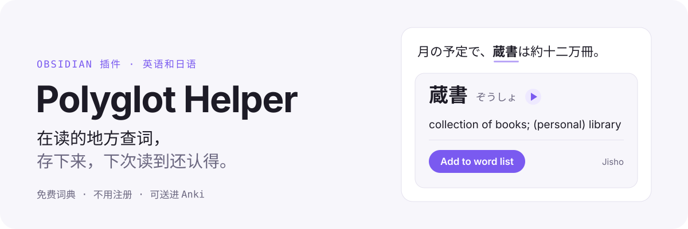
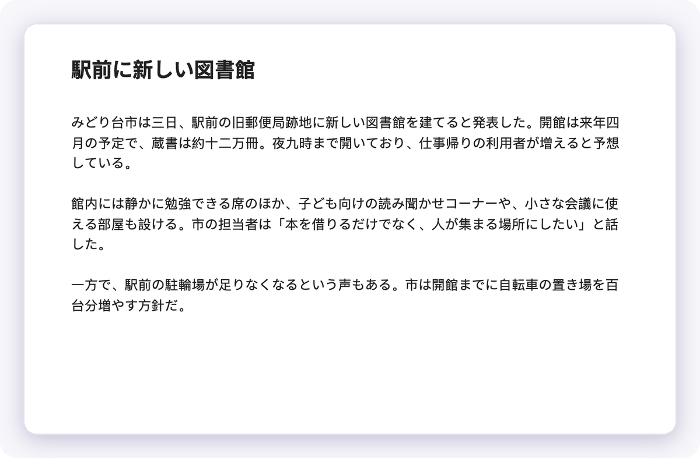
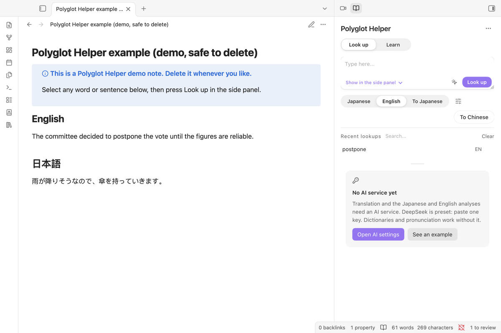
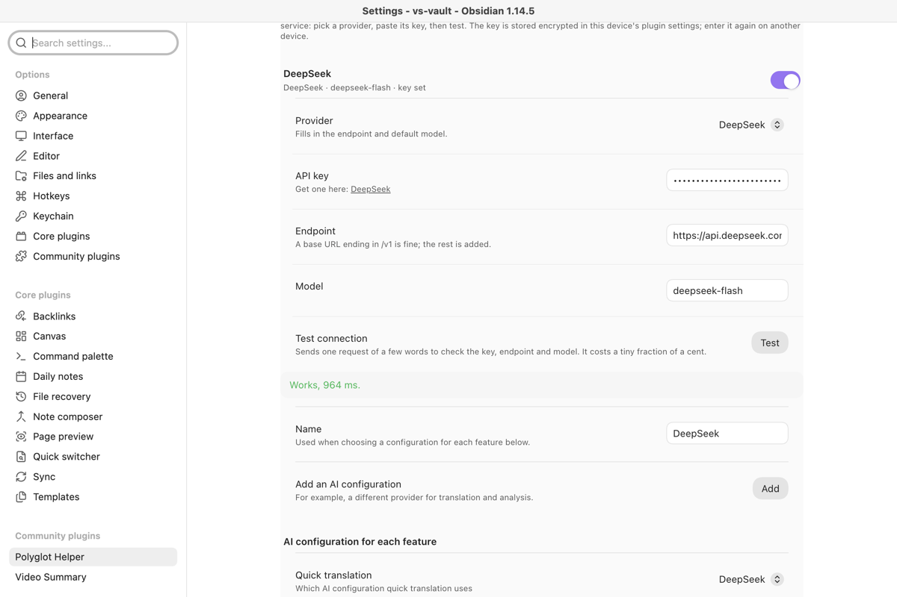
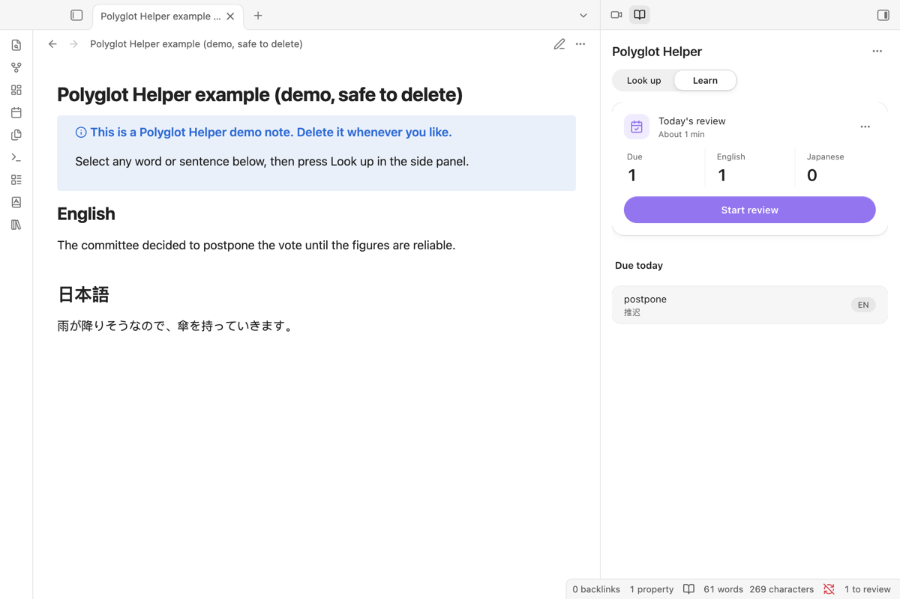
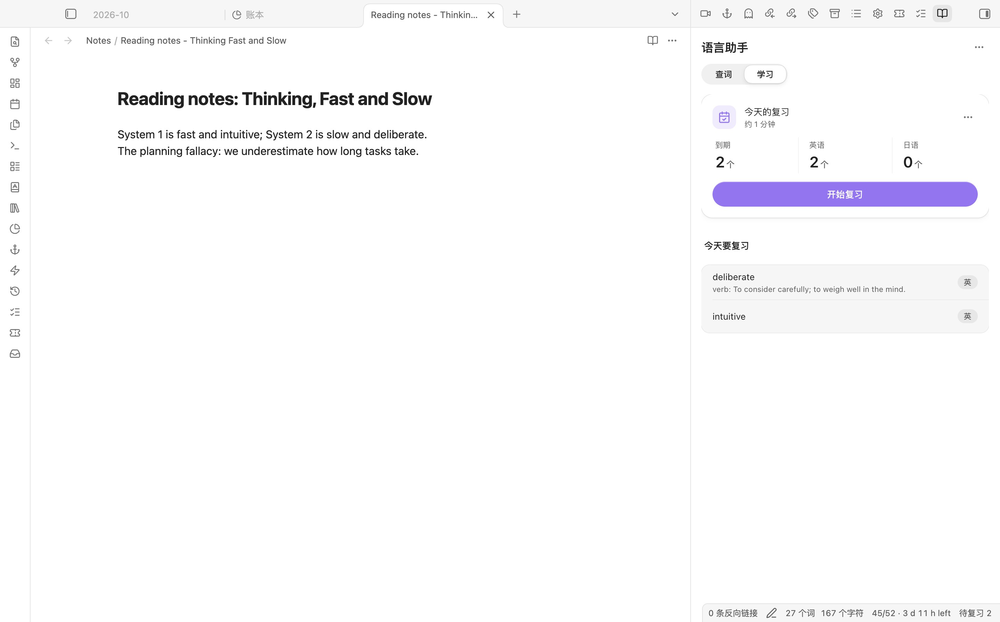

<a href="README.md">English</a> · <a href="README.ja.md">日本語</a>

<picture>
  <source media="(prefers-color-scheme: dark)" srcset="assets/readme/hero-zh-dark.svg">
  
</picture>

<a href="https://community.obsidian.md/plugins/polyglot-helper"><b>在 Obsidian 里安装</b></a>

<picture>
  <source media="(prefers-color-scheme: dark)" srcset="assets/readme/demo-dark.gif">
  
</picture>

<picture>
  <source media="(prefers-color-scheme: dark)" srcset="assets/readme/cards-zh-dark.svg">
  
</picture>

## 三步上手

1. 在“设置 → 第三方插件 → 浏览”里搜索 **Polyglot Helper**，安装并启用。
2. 在笔记里选中一个词，右键选 **查词小卡**。
3. 点 **加入生词本**。它会按时回来让你复习，以后读到它也会加下划线。

**需要** Obsidian 1.11.4 或更新，电脑和手机都能用。**费用** 插件和词典不要钱，不用注册。完整词条和“本句里的意思”要用你自己的一个兼容 OpenAI 格式的密钥（默认 DeepSeek），由服务商按用量收费，查一个词是一次很短的请求。

截图是英文界面。Obsidian 设为中文时，插件界面也是中文。

## 其余内容

<b>第一次使用的完整步骤</b>

1. 安装并启用 Polyglot Helper，点左侧功能区的书本图标打开侧栏。
2. 点 **载入示例**：插件会写一篇标着“演示，可删除”的短笔记，并把 postpone 填进查词框。
3. 选择或新建一个 AI 密钥：**设置 → Polyglot Helper → 翻译与模型**。默认已选 DeepSeek，填好后点 **测试**。
4. 点 **查词**。以后在任何笔记里选中一个词，同样查；点 **加入生词本** 就会进入复习。

<b>生词本</b>

- 加词时记下来自哪篇笔记和日期（`收自 [[笔记]] · 日期`）；光标在某一行时，那句话会作为例句一起存下。
- 同一个词再加一次是合并，不是覆盖：你改过的释义保留，空着的栏补上，例句、标签和来源去重后合在一起。
- 收过的词再收一次时，可以把这句并进已有的某个义项，或者另存为新义项；每个义项单独复习，复习时正面给出原句。
- 阅读视图里，生词本里的词自动加下划线，日语动词、形容词变了形也认得（食べた 对应 食べる）；指针停上去看读音和意思。
- “发送词库到 Anki”经 AnkiConnect 插件一步送进 Anki：新词新建卡片，改过的更新，不会重复。
- “导出词库为闪卡笔记”生成 Spaced Repetition 插件能复习的笔记，卡片背面带例句和出处回链；每张卡有稳定 ID，重新导出会保留复习排程。也可以导出为 Anki 导入文件，再次导入时更新原卡，不会多出重复卡。

完整功能、联网说明和更新记录见 [英文说明](README.md) 和 [CHANGELOG.md](CHANGELOG.md)。

<table>
<tr>
<td width="50%"> 还没配置时，侧栏会说缺什么，并给出“打开 AI 设置”和“先看示例”。</td>
<td width="50%"> 服务商、密钥、接口地址和模型分开填；<b>测试</b> 会直接说出哪里不对。</td>
</tr>
<tr>
<td width="50%"> 加进生词本的词，到期后出现在学习页。</td>
<td width="50%"> 一次复习一张卡，按记得的程度打分。</td>
</tr>
</table>

<b>需要什么、花多少钱</b>

| | |
|---|---|
| 插件本身 | 免费，不用注册账号，电脑和手机都能用，需要 Obsidian 1.11.4 或更新。 |
| AI 服务 | 一个兼容 OpenAI 格式的密钥。预设有 DeepSeek（默认）、通义千问、硅基流动、Kimi、智谱、OpenRouter、OpenAI，也可以填任何兼容接口。费用由服务商按用量收取，查一个词是一次很短的请求；**测试** 一次花费不到一分钱。硅基流动账户余额为 0 时，连免费模型也会拒绝。 |
| 词典和发音 | 免费公开来源，不需要密钥。可选：Merriam-Webster 密钥（同义词、医学释义），以及 OpenAI、Gemini 或有道的日语语音密钥。 |

<b>AI 服务</b>

在 **设置 → 翻译与模型** 里选服务商，接口地址和模型会自动填好，你只需要选好密钥。接口地址写到 `/v1` 也可以，插件会补上 `/chat/completions`。

| 服务商 | 默认模型 | 在哪里拿密钥 |
|---|---|---|
| DeepSeek（默认） | `deepseek-flash` | [platform.deepseek.com](https://platform.deepseek.com/api_keys) |
| 通义千问 | `qwen-plus` | [百炼控制台](https://bailian.console.aliyun.com/?apiKey=1) |
| 硅基流动 | `deepseek-ai/DeepSeek-V4.1-Flash` | [cloud.siliconflow.cn](https://cloud.siliconflow.cn/account/ak) |
| Kimi | `kimi-k3` | [platform.kimi.com](https://platform.kimi.com/console/api-keys) |
| 智谱 | `glm-5.3` | [bigmodel.cn](https://bigmodel.cn/usercenter/proj-mgmt/apikeys) |
| OpenRouter | `google/gemini-2.5-flash` | [openrouter.ai](https://openrouter.ai/keys) |
| OpenAI | `gpt-4o-mini` | [platform.openai.com](https://platform.openai.com/api-keys) |

**测试** 能分清这几种情况，并说该怎么办：还没填密钥；密钥被拒（401／403）；余额或额度不足；模型名不存在；等太久没回应；连不上接口地址。

<b>数据发到哪里、存在哪里</b>

| 内容 | 发给谁 | 存在哪里 |
|---|---|---|
| 你查的词或句子 | 你启用的词典和 AI 服务 | 插件文件夹里的查词缓存 |
| API 密钥 | 只发给它所属的服务商 | 存在本机 Obsidian 的钥匙串里（**设置 → 钥匙串**）。`data.json` 只记密钥的名字，比如 `deepseek-api-key`，用同一个名字的其他插件可以直接选这把密钥。密钥不随库同步，换设备后要重新选一次。 |
| 生词本和复习记录 | 不发送；用“发送词库到 Anki”时，只发给本机的 AnkiConnect（`127.0.0.1:8765`） | 插件文件夹里的 `data.json` |
| 调试日志 | 不发送 | 只在开启调试模式时写；密钥和查询的原文不写进日志 |

<b>安装</b>

1. 从 [最新版本](https://github.com/Rexxall/obsidian-polyglot-helper/releases/latest) 下载 `main.js`、`manifest.json`、`styles.css`，放进 `<库>/.obsidian/plugins/polyglot-helper/`。（上架社区插件后，可以直接在 **设置 → 第三方插件 → 浏览** 里安装。）
2. 在 **设置 → 第三方插件** 里启用 **Polyglot Helper**。
3. 在插件设置里选服务商、选密钥、点 **测试**。
4. 在侧栏查词，或在命令面板运行“英语分析”“日语分析”。常用的话可以设快捷键。

从 1.9.1 起，Release 里的三个文件都由发布工作流附上签名的构建来源证明（build provenance attestation）。核对下载的文件：`gh attestation verify main.js --repo Rexxall/obsidian-polyglot-helper`。

**从 1.5 及更早版本升级：** 插件 ID 改为 `polyglot-helper`。先停用旧版再启用新版，新版首次启动会自动导入旧目录里的设置、API 密钥和两个生词本；确认无误后删除旧版，快捷键需要重设一次。

MIT
